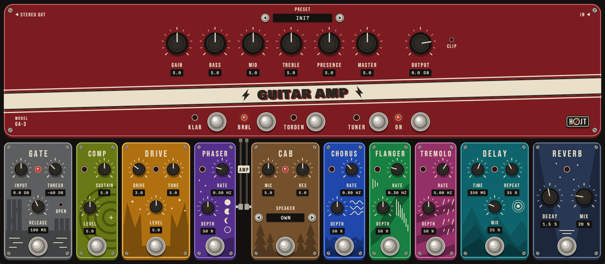
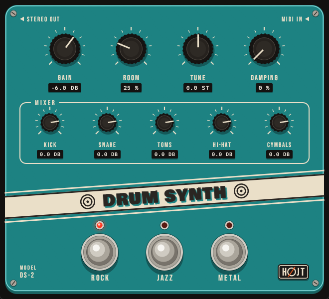
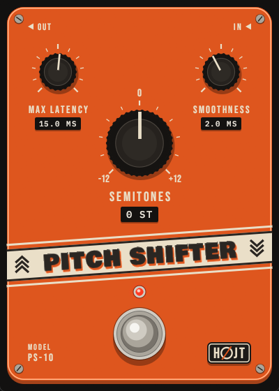

# HØJT Audio

Free audio plugins for guitar and drums, each drawn as a stompbox. VST3 and CLAP, for Windows,
macOS and Linux. HØJT is Danish for loud, and for high.

**[The page, with sound examples and downloads](https://hojte.net/hojt-audio/)** ·
**[Latest release](https://github.com/FrankDrebin893/hojt-audio/releases/latest)**

[](https://hojte.net/hojt-audio/#guitar-amp)

| | |
|---|---|
| [](https://hojte.net/hojt-audio/#drum-synth) | [](https://hojte.net/hojt-audio/#pitch-shifter) |

## The plugins

**Guitar Amp** (`plugins/amp`). A whole rig: three amps of our own design, each with its own
cabinet (Klar: clean, Brøl: crunch, Torden: high gain), and ten pedals that can be dragged into
another order: gate, compressor, overdrive, phaser, chorus, flanger, tremolo, cabinet, delay and
reverb. It plays your own cabinet impulse responses, has presets and a tuner, and adds 0.1 to
0.3 ms of latency.

**Drum Synth** (`plugins/drums`). A full drum kit with no samples: every sound is made in the
plugin. Three kits (Rock, Jazz, Metal), General MIDI drum map, and velocity that changes the
sound and not only the level.

**Pitch Shifter** (`plugins/pitch_shifter`). Shifts a guitar by -12 to +12 semitones for live
playing. The delay follows the note being played: about 12 ms on the low E string, under 3 ms
high up the neck.

## Install

Download the zip for your system from the [page](https://hojte.net/hojt-audio/)
or the [latest release](https://github.com/FrankDrebin893/hojt-audio/releases/latest), and copy
the `.vst3` or the `.clap` to its folder:

| System | VST3 | CLAP |
|--------|------|------|
| Windows | `C:\Program Files\Common Files\VST3` | `C:\Program Files\Common Files\CLAP` |
| macOS | `~/Library/Audio/Plug-Ins/VST3` | `~/Library/Audio/Plug-Ins/CLAP` |
| Linux | `~/.vst3` | `~/.clap` |

On macOS, run `xattr -dr com.apple.quarantine <the file you copied>` once afterwards. The macOS
and Linux builds come from the build server and have not been tried in a DAW yet.

## Build from source

Requires [Rust](https://rustup.rs/). On Linux also the packages listed in
[.github/workflows/ci.yml](.github/workflows/ci.yml).

```bash
# VST3 and CLAP bundles in target/bundled
cargo xtask bundle pitch_shifter --release
cargo xtask bundle drums --release
cargo xtask bundle amp --release

# Tests
cargo test --workspace

# A plugin's window as a program, without a DAW and without sound
cargo run -p amp --features standalone -- --backend dummy
```

The plugins are written in Rust on [NIH-plug](https://github.com/robbert-vdh/nih-plug).
[CLAUDE.md](CLAUDE.md) describes how each one works, its parameters and the tools for working
on its sound.

## Licence

Copyright (c) 2026 Rasmus Højte. Free software under the
[GNU General Public License](LICENSE), version 3 or later. The name HØJT and its logo are not
part of that licence, and third-party components keep their own: see [NOTICE.md](NOTICE.md).
